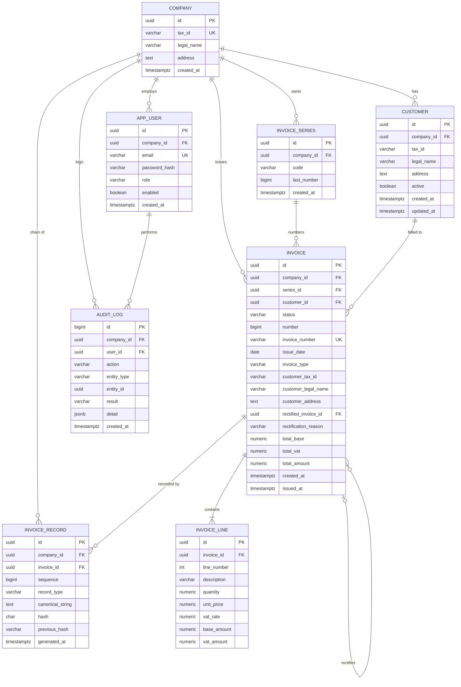

# Modelo de dominio y esquema de base de datos

Estado: propuesto, pendiente de la migración V1.
Requisitos relacionados: RF-01 a RF-05, RF-13, RF-15, RNF-01, RNF-03, RN-01 a RN-05.
Reglas de la huella: `docs/design/hash-specification.md` y ADR-002.

## Decisiones confirmadas

| Tema | Decisión |
|---|---|
| Borradores | Misma tabla `invoice` con estado `DRAFT` o `ISSUED`. Se edita en `DRAFT`. Una vez emitida, un trigger bloquea cualquier cambio. |
| Datos del cliente | La factura guarda una copia de los datos fiscales del cliente al emitir. Editar el cliente después no cambia facturas emitidas. |
| Usuarios | Un usuario pertenece a una sola empresa. |
| Numeración | Correlativa continua por serie, sin reinicios. El año puede ir en el código de la serie (por ejemplo `A2026`). |
| Cadena de huellas | Una cadena por empresa, no por serie. |
| Estado de anulación | Derivado: una factura está anulada si existe un registro de anulación que la referencia. No se guarda en la factura. |
| Importes | `NUMERIC(14,2)` en la base de datos y `BigDecimal` en Java. Nunca `double`. |
| Identificadores | `UUID` en las tablas que expone la API. `bigint` autogenerado en `audit_log`, que es interno. |
| Fechas y horas | `TIMESTAMPTZ` para instantes. `DATE` para la fecha de expedición. |
| Multi-tenant | Columna `company_id` en todas las tablas de negocio. |

## Diagrama entidad-relación

## Tablas

### company
La empresa o autónomo titular. Es la unidad de aislamiento (RF-13) y de cadena de huellas. `tax_id` es el NIF y se usa como `IDEmisorFactura` en la huella.

### app_user
Usuario con email único, hash de contraseña (bcrypt o Argon2, RNF-04), rol y una única empresa. Roles previstos:
- `ADMIN`: gestiona usuarios, series y clientes, y emite.
- `ISSUER`: emite facturas.
- `AUDITOR`: solo consulta y verifica.

### customer
Cliente de la empresa, con datos fiscales editables. `active` permite desactivarlo sin borrarlo (RF-16).

### invoice_series
Serie de numeración, por ejemplo `A2026`. `last_number` es el contador. Único por `(company_id, code)`.

### invoice
Cabecera de factura.
- En `DRAFT`: `number`, `invoice_number`, `issued_at` y los campos de copia del cliente están vacíos.
- Al emitir se rellenan todos y el estado pasa a `ISSUED`.
- `invoice_number` es el valor de `NumSerieFactura` de la huella (por ejemplo `A2026-000001`). Único por empresa.
- `invoice_type` almacena el `TipoFactura` oficial (por ejemplo `F1`).
- `rectified_invoice_id` y `rectification_reason` solo se usan en rectificativas (RF-05).
- Restricción: `total_amount = total_base + total_vat`.

### invoice_line
Líneas de la factura. `vat_rate` solo admite 21, 10, 4 y 0 (RN-02). `base_amount` y `vat_amount` se redondean a 2 decimales por línea y los totales de la factura son la suma de las líneas (RN-01). La suma de líneas la valida el servicio de dominio.

### invoice_record
Registro de la cadena de huellas. Solo se inserta.
- `sequence`: posición del registro en la cadena de su empresa. Único por `(company_id, sequence)`.
- `record_type`: `ALTA` o `ANULACION`.
- `canonical_string`: la cadena exacta sobre la que se calculó la huella.
- `hash`: 64 caracteres hexadecimales en mayúsculas.
- `previous_hash`: huella del registro anterior. Cadena vacía en el primero, nunca null (ADR-002).
- `generated_at`: instante de generación, equivale a `FechaHoraHusoGenRegistro`.

Restricciones que protegen la cadena:
- Único `(company_id, previous_hash)`: impide bifurcar la cadena.
- Único `(company_id, hash)`.
- Índice único parcial sobre `invoice_id` donde `record_type = 'ALTA'`: una sola alta por factura.
- Índice único parcial sobre `invoice_id` donde `record_type = 'ANULACION'`: una sola anulación por factura (RN-04).

### audit_log
Registro de auditoría (RF-15) con usuario, acción, entidad, resultado y detalle. Solo se inserta.

### Pendiente para más adelante
`chain_verification` (historial de verificaciones programadas, RF-07) se añade en una migración posterior, porque es un requisito S.

## Estado de una factura

| Estado | Cómo se obtiene |
|---|---|
| Borrador | `invoice.status = 'DRAFT'` |
| Emitida | `invoice.status = 'ISSUED'` y no existe registro `ANULACION` para ella |
| Anulada | Existe un registro `ANULACION` con `invoice_id` igual al de la factura |

La fila de una factura emitida no cambia nunca, ni siquiera al anularla.

## Inmutabilidad (RNF-01)

Se aplica con triggers, para que ninguna ruta de código pueda saltársela:

| Tabla | Regla |
|---|---|
| `invoice_record` | Error en cualquier `UPDATE`, `DELETE` o `TRUNCATE`. |
| `audit_log` | Error en cualquier `UPDATE`, `DELETE` o `TRUNCATE`. |
| `invoice` | Error en `UPDATE` o `DELETE` cuando la fila ya está en `ISSUED`. La transición `DRAFT` a `ISSUED` sí está permitida. |
| `invoice_line` | Error en `INSERT`, `UPDATE` o `DELETE` cuando la factura padre está en `ISSUED`. |

Limitación conocida: un superusuario de PostgreSQL puede desactivar los triggers o reescribir la cadena. Las mitigaciones están descritas en el ADR-002 y en el backlog de fase 2.

## Aislamiento entre empresas

Todas las tablas de negocio llevan `company_id`. Para evitar que una factura apunte a la serie o al cliente de otra empresa, las claves foráneas son compuestas: las tablas padre declaran `UNIQUE (id, company_id)` y las hijas referencian `(series_id, company_id)`, `(customer_id, company_id)` o `(invoice_id, company_id)`. La base de datos rechaza cualquier cruce entre empresas, aunque falle un filtro en el código.

## Emisión de una factura

Todo ocurre en una sola transacción (RF-02 CA2: si algo falla, no se consume ningún número):

1. Bloquear la fila de `company` con `SELECT ... FOR UPDATE`. Serializa las emisiones de la empresa y protege el final de la cadena.
2. Bloquear la fila de `invoice_series` con `SELECT ... FOR UPDATE` (RN-03).
3. Calcular `number = last_number + 1` y actualizar `last_number`.
4. Leer la huella del último registro de la cadena de la empresa (cadena vacía si no hay ninguno).
5. El servicio de dominio construye la cadena canónica y calcula la huella.
6. Insertar el registro en `invoice_record`.
7. Actualizar la factura: `ISSUED`, número, copia de los datos del cliente y `issued_at`.
8. Insertar la entrada de auditoría y confirmar la transacción.

El orden de bloqueo es siempre empresa y después serie, para evitar interbloqueos.

## Anulación

Inserta un registro `ANULACION` encadenado que referencia la factura original. No se modifica ninguna fila existente. Si la factura ya tiene una anulación, el índice único parcial lo rechaza (RN-04).

## Puntos abiertos

- Cómo se representa una rectificativa en el registro oficial: este diseño la modela como una factura con `invoice_type` propio que referencia a la original, pendiente de confirmarlo en los diseños de registro de la AEAT.
- Formatos de fecha e importe en la cadena canónica: pendiente de contrastar con los esquemas XSD.
- Verificación programada y notificaciones (RF-07 y RF-17): fuera de la migración V1.

## Plan de migraciones

| Migración | Contenido |
|---|---|
| `V1__base_schema.sql` | `company`, `app_user`, `customer`, `invoice_series`, `invoice`, `invoice_line`, con claves, restricciones e índices. |
| `V2__ledger_and_immutability.sql` | `invoice_record`, `audit_log`, índices únicos parciales y triggers de inmutabilidad. |
